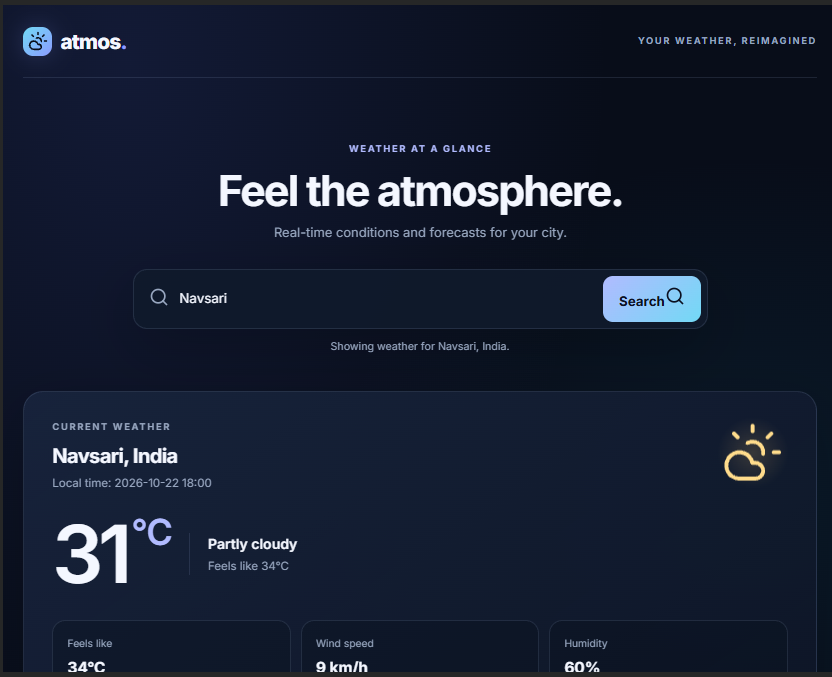
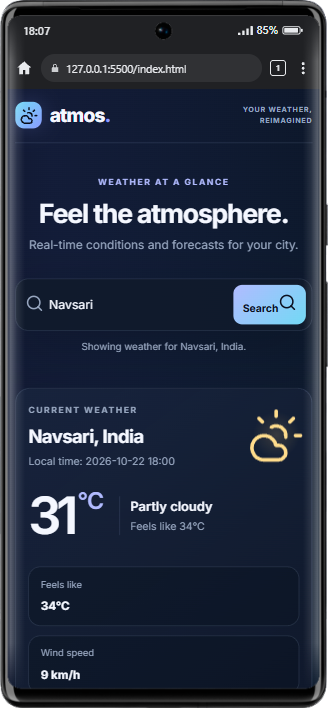
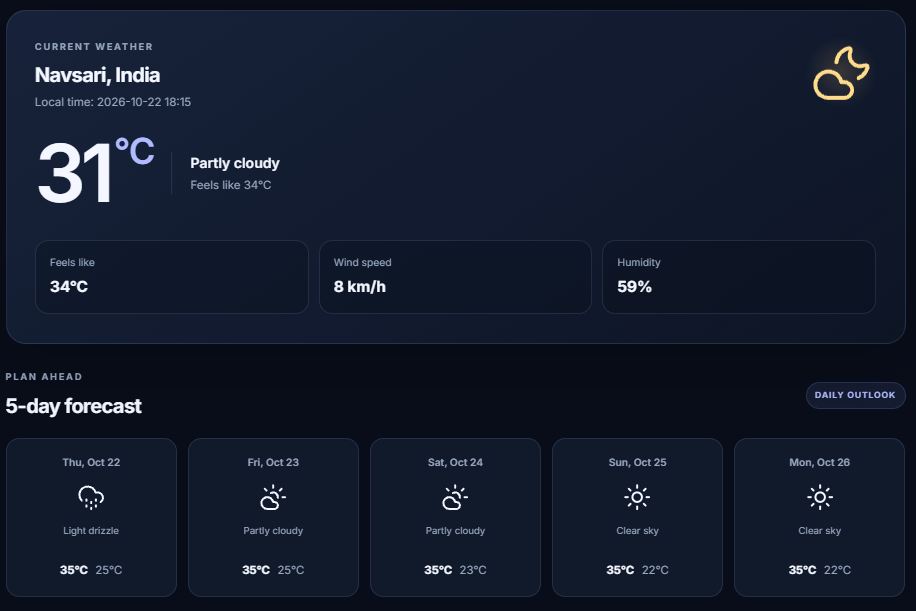

  
# 🌤️ Atmos — Weather Dashboard

A modern, responsive weather dashboard built with HTML, CSS, and vanilla JavaScript. Atmos allows users to search for cities and explore current weather conditions and upcoming forecasts through a clean, dark-themed interface.

## 📸 Screenshots

### Desktop View


### Mobile View


### Weather Search and Forecast


## ✨ Features

- **City Search:** Search for a city to retrieve its weather information.
- **Current Weather:** View the current temperature, weather conditions, and apparent temperature.
- **Weather Details:** Display humidity and wind speed.
- **Weather Forecast:** View upcoming daily forecasts with weather icons and high/low temperatures.
- **Dynamic Weather Icons:** Use Lucide icons to represent different weather conditions.
- **Loading Feedback:** Display a loading message while weather data is retrieved.
- **Error Handling:** Show a helpful message when a city cannot be found or a request fails.
- **Responsive Design:** Adapt the dashboard to desktop, tablet, and mobile screen sizes.
- **Modern UI:** Dark navy styling, glassmorphism-inspired elements, and subtle transitions.
- **Accessible Interaction:** Use semantic HTML, clear status messages, and reduced-motion styling.

## 🛠️ Technologies Used

| Technology | Purpose |
|---|---|
| HTML5 | Page structure and semantic markup |
| CSS3 | Styling, responsive layouts, animations, and visual effects |
| JavaScript (ES Modules) | Search logic, API integration, and dynamic rendering |
| Open-Meteo Geocoding API | Convert city names into geographic coordinates |
| Open-Meteo Forecast API | Retrieve current weather and daily forecasts |
| Lucide | Consistent, scalable interface and weather icons |
| Google Fonts — Inter | Typography |

## 🌐 APIs and Resources

Atmos uses Open-Meteo to retrieve location and weather information.

- **Geocoding API:** open-meteo.com
- **Forecast API:** open-meteo.com
- **API Documentation:** open-meteo.com
- **Lucide Icons:** https://lucide.dev/icons/
- **Google Fonts:** https://fonts.google.com/specimen/Inter

Weather information is retrieved dynamically rather than being hardcoded into the dashboard.

### Attribution

Weather data is provided by [Open-Meteo](https://open-meteo.com/). Review the [Open-Meteo terms and attribution requirements](https://open-meteo.com/en/terms) before publishing or using the project commercially.

## 🚀 Getting Started

### Prerequisites

- A modern web browser
- Visual Studio Code or another code editor
- A local development server, such as the VS Code Live Server extension
- An internet connection to retrieve API data and load external fonts and icons

### 1. Clone the repository

Replace the placeholder below with your actual GitHub repository URL.

```bash
git clone YOUR_GITHUB_REPOSITORY_URL
```

### 2. Open the project

```bash
cd weather-dashboard
```

Open the project folder in Visual Studio Code.

### 3. Start a local server

Because Atmos uses JavaScript ES modules, run it through a local development server rather than opening `index.html` directly using a `file://` URL.

In Visual Studio Code:

1. Install the **Live Server** extension if necessary.
2. Open `index.html`.
3. Right-click the file and select **Open with Live Server**.
4. Your browser will open the dashboard.

### 4. Explore the dashboard

- Search for a city, such as Mumbai or London.
- Review the current weather details.
- Explore the daily forecast cards.
- Try an invalid city to check the error message.
- Resize the browser or use device emulation to test responsiveness.

## 📁 Project Structure

```text
weather-dashboard/
├── index.html
├── css/
│   └── styles.css
├── js/
│   ├── api.js
│   ├── ui.js
│   └── main.js
├── screenshots/
│   ├── desktop.png
│   ├── mobile.png
│   └── forecast.png
└── README.md
```

The `screenshots/` directory and its image files are to be added; they are not assumed to exist yet.

## 🧠 What I Learned

Through this project, I practised:

- Fetching and processing data from external APIs.
- Working with asynchronous JavaScript and ES modules.
- Separating API logic, UI rendering, and application control into modular files.
- Updating the DOM dynamically based on API responses.
- Handling loading states and invalid search results.
- Designing responsive interfaces using CSS.
- Integrating third-party icon libraries.
- Testing a web application across different viewport sizes.

## 🔮 Future Improvements

Potential enhancements include:

- Celsius/Fahrenheit unit switching.
- Browser-based location detection with user permission.
- Search suggestions and recent cities.
- Hourly forecast charts.
- Theme switching.
- Improved offline and network-error handling.

## 👩‍💻 Author

**Riddhi Mistry**

Computer Science and Engineering Student | Aspiring Frontend Developer

Explore my other projects and repositories on [GitHub](https://github.com/riddhimistry141).

---

*Built as a frontend development portfolio project to practise JavaScript, API integration, responsive design, and modular web development.*
